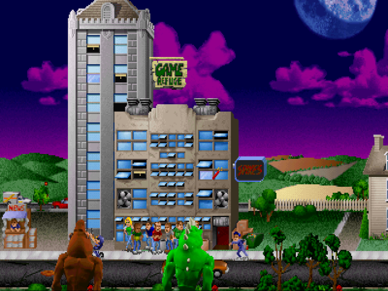
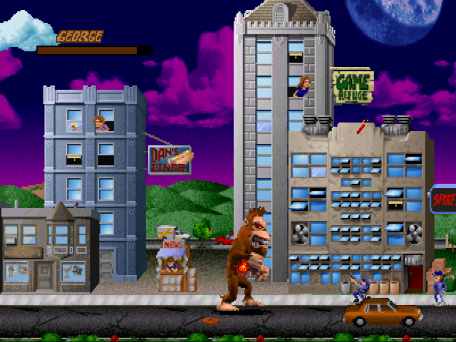
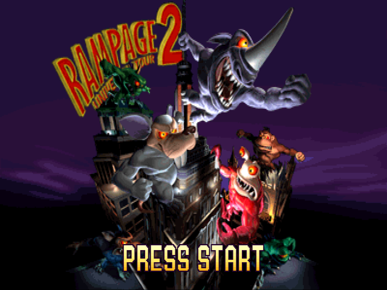
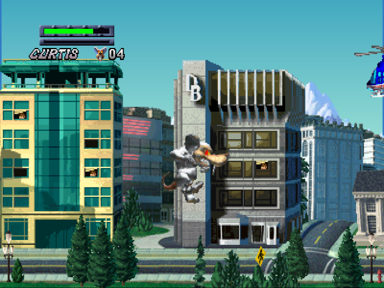

# Rampage Recompiled

A native Windows port of **Rampage: World Tour** (N64, 1998) and **Rampage 2: Universal Tour**
(N64, 1999), made by statically recompiling the games' own code with
[N64Recomp](https://github.com/N64Recomp/N64Recomp). You supply your own ROMs; nothing from the
games is in this repo or downloaded by it.

## Status

**v0.2.0, alpha.** Both games boot, take input and play.

| | Rampage: World Tour | Rampage 2: Universal Tour |
|---|---|---|
| Boots to title, attract mode | yes | yes |
| Menus, character select | yes | yes |
| Gameplay (move, climb, punch, eat) | yes | yes (first levels tried) |
| Controllers: keyboard and up to 4 pads, configurable | yes | yes |
| Graphics (RT64, D3D12) at any resolution | yes | yes |
| Sound and music | no: silent ([ROADMAP](ROADMAP.md)) | no: silent |
| Controller pak saves | no: the game says no pak is inserted | no |
| Platforms | Windows 10/11 x64 | Windows 10/11 x64 |

How the two games are made to work, and what had to be fixed on the way:
[docs/symbols.md](docs/symbols.md) and [docs/game-fixes.md](docs/game-fixes.md).

## Screenshots

| | |
|---|---|
|  |  |
| *World Tour: attract demo* | *World Tour: George in Peoria* |
|  |  |
| *Rampage 2: title* | *Rampage 2: Curtis, and trouble* |

All captured from the real build (`--headless` with `RAMPAGE_SHOT`, see [Usage](#usage)).

## Getting Started

You need a Windows 10/11 x64 PC with a DirectX 12 GPU, about 8 GB of free disk, and your own
USA ROM of either game as a `.z64` file (big-endian, the usual No-Intro dump: World Tour CRC
`C29FF9E4`, Rampage 2 CRC `673D099B`).

### Quick start

1. Download this repo ([Code → Download ZIP](https://github.com/sp00nznet/Rampage/archive/refs/heads/main.zip))
   and unzip it anywhere.
2. Put your ROM(s) in that folder. Any file name works.
3. Double-click **`Setup.cmd`**. It checks for Git, Python, CMake and Visual Studio's C++ build
   tools, and asks before installing any that are missing (through winget). It then downloads the
   recompiler, runtime and renderer, recompiles your ROMs and builds the games. The first run takes
   30 to 60 minutes; a rerun after a failure picks up where it stopped. If it stops, it says why in
   one sentence; the full log is `logs\setup.log`.
4. Double-click **`Rampage World Tour (recomp).cmd`** or **`Rampage 2 Universal Tour (recomp).cmd`**.

### Step by step

Each command runs in the repo folder. Expected output is shown where it tells you something.

1. Install the prerequisites: [Git](https://git-scm.com/), [Python 3.10+](https://www.python.org/)
   (the `py` launcher), [CMake 3.20+](https://cmake.org/), and Visual Studio 2022 (or its Build
   Tools) with the **Desktop development with C++** workload. Open a new terminal afterwards so
   `PATH` is current.
2. Get the toolkits. Rampage builds against sp00nznet's forks, each carrying fixes it needs (and has
   sent upstream as PRs, listed in [docs/building.md](docs/building.md)):
   ```
   git clone --recurse-submodules -b fix/fallthrough-tail-call https://github.com/sp00nznet/N64Recomp deps\N64Recomp
   git clone --recurse-submodules -b rampage https://github.com/sp00nznet/N64ModernRuntime deps\N64ModernRuntime
   git clone --recurse-submodules -b rampage https://github.com/sp00nznet/rt64 deps\rt64
   ```
3. Build the recompiler:
   ```
   cmake -S deps\N64Recomp -B deps\N64Recomp\build -G "Visual Studio 17 2022" -A x64
   cmake --build deps\N64Recomp\build --config Release --target N64RecompCLI
   ```
4. Copy your ROM into the repo folder under the name the game's `.toml` expects:
   `Rampage - World Tour (U) [!].z64` and/or `Rampage 2 - Universal Tour (U) [!].z64`.
5. Recompile it (`wt` for World Tour, `r2` for Rampage 2):
   ```
   set N64RECOMP=deps\N64Recomp\build\Release\N64Recomp.exe
   py tools\regen.py wt
   ```
   ```
   wt: 70 files in gen/wt, 438 fallthroughs, 0 warnings (full log: gen/wt.log)
   ```
   Rampage 2 prints `r2: 82 files in gen/r2, 420 fallthroughs, 0 warnings`.
6. Build:
   ```
   cmake -S . -B build\wt -G "Visual Studio 17 2022" -A x64 -DRAMPAGE_GAME=wt
   cmake --build build\wt --config Release --parallel
   ```
   The game is `build\wt\Release\RampageWorldTour.exe` (`build\r2\Release\Rampage2.exe` for
   Rampage 2).
7. Run it from the repo folder (it finds the ROM there): `build\wt\Release\RampageWorldTour.exe`.

Usual trip-ups: `python` opening the Microsoft Store means the Store alias is on; use `py`, or
turn the alias off in Settings → Apps → Advanced app settings → App execution aliases. A tool
"not found" right after installing it means the terminal predates the install: open a new one.

## Usage

Controls (defaults; change them in `rampage.json` next to the exe, written on first run):

| N64 | Keyboard | Pad |
|---|---|---|
| Stick | W A S D / arrows | left stick |
| A / B | Enter or Space / Left Shift | A / X |
| Start | Esc or P | Start |
| C buttons | numpad 8 4 6 2 | right stick, Y / B |
| D-pad | I J K L | D-pad |
| Z / L / R | Z / Q / E | left trigger / shoulders |

Player 1 gets the keyboard and the first pad; players 2 and 3 get the next pads. F11 or Alt+Enter
toggles fullscreen.

For testing and debugging, the exe takes `--headless` (the window sits off-screen, never on your
monitors, and is still rendered) and these environment variables:

| Variable | Does |
|---|---|
| `RAMPAGE_SHOT=10:a.bmp,30:b.bmp` | saves the window to those files at those times (seconds) |
| `RAMPAGE_QUIT_AFTER=40` | quits after that many seconds |
| `RAMPAGE_AUTOPRESS=12:1000,15:8000` | holds N64 buttons (hex mask: 1000 Start, 8000 A) for 0.25 s at those times |
| `RAMPAGE_STACKDUMP=20` | prints every thread's stack at that time, for hangs |
| `RAMPAGE_WATCH=0x801732A0@5` | after 5 s, reports the first write to that RDRAM word and who did it |
| `RAMPAGE_PEEK=0x801732A0,...` | prints those RDRAM words with a stack dump or crash |
| `RAMPAGE_DISPLAY=1` | opens on that monitor |

```
set RAMPAGE_SHOT=25:demo.bmp
set RAMPAGE_QUIT_AFTER=26
build\wt\Release\RampageWorldTour.exe --headless
```

## Building from source

The step-by-step route above is the build. [docs/building.md](docs/building.md) covers the
toolkit branches, what each step produces, using your own toolkit checkouts, and the generated
code (`gen/`, never committed). [docs/architecture.md](docs/architecture.md) explains how the
pieces fit.

This is a [N64Recomp](https://github.com/N64Recomp/N64Recomp) project in sp00nznet's recomp house
style: the toolkit ships, the generated code never does, and fixes found here go back to the
toolkits as PRs.

Want to help? [CONTRIBUTING.md](CONTRIBUTING.md).

## License

This repo's own code is MIT, see [LICENSE](LICENSE). A built game links
[N64ModernRuntime](https://github.com/N64Recomp/N64ModernRuntime), which is GPL-3.0, so the exe as a
whole falls under GPL-3.0; N64Recomp and RT64 are MIT, SDL2 zlib. No builds are distributed: you
make your own from your own copy. Rampage is © Midway; none of the games' code or data is here.
