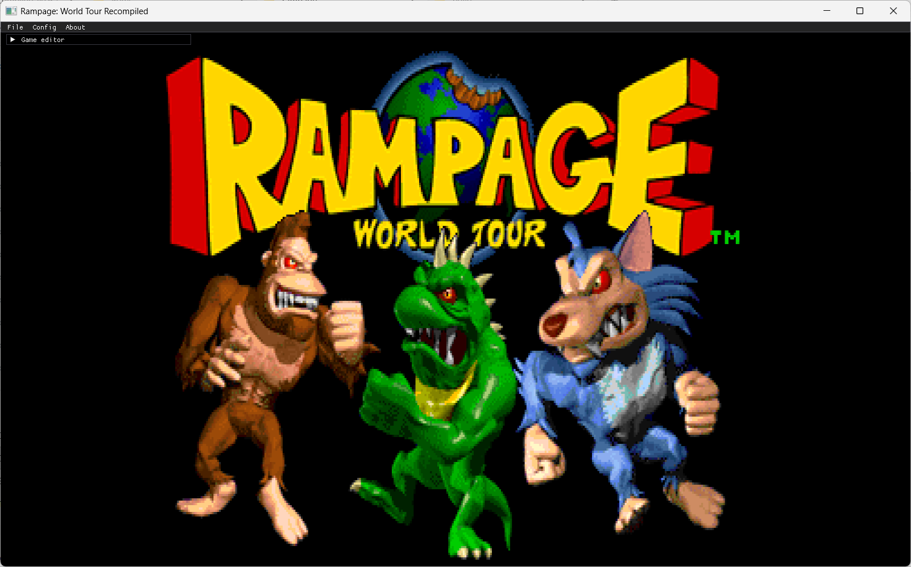
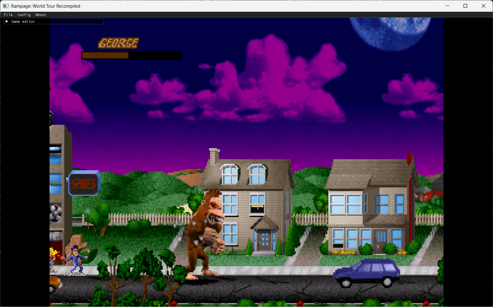
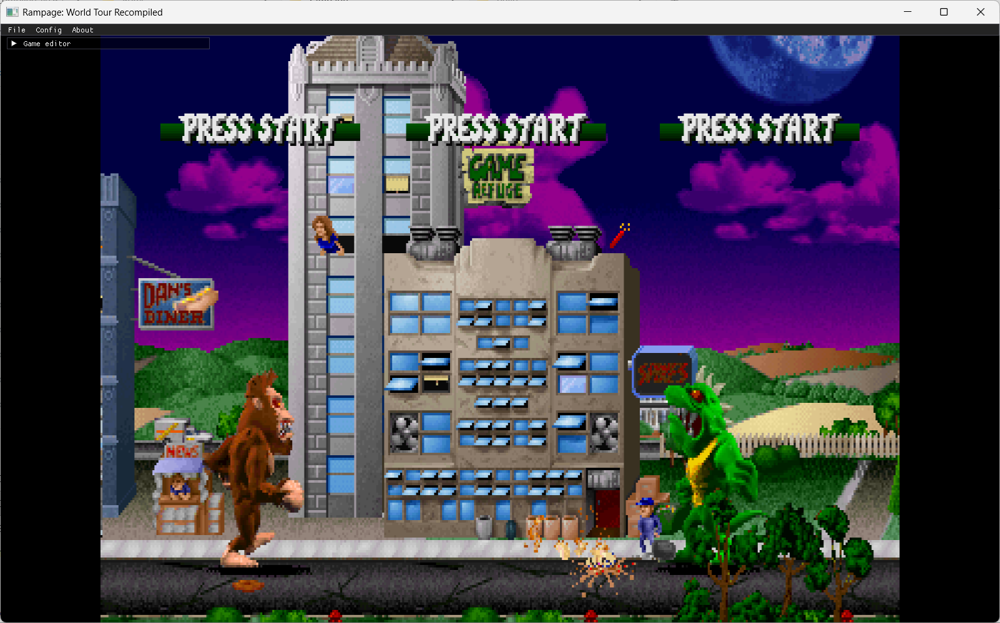

# Rampage Recompiled

A PC port of **Rampage World Tour** (N64, 1997) and **Rampage 2: Universal Tour** (N64, 1999) using static recompilation via [N64Recomp](https://github.com/Mr-Wiseguy/N64Recomp).

## Current Status

### Rampage: World Tour - PLAYABLE
Fully playable at 60fps. All game states work: title screen, menus, character select, and gameplay. Keyboard and controller input, demo mode, ImGui menu bar. No audio output yet (SN64 engine stubbed).

### Rampage 2: Universal Tour - RENDERING, HANGS AT TITLE
Boots fully and the **RSP task pipeline now works end-to-end**: graphics and audio display lists are submitted via `osSpTaskStartGo`, RT64 processes them, and the framebuffer is found and presented (`FOUND_FB=1`). Runs continuously without crashing. **Current blocker:** the game thread hangs at the title screen (state 0x0110) inside an SI controller-read routine (`func_80072840` blocks on `osRecvMesg` because the SI DMA-start `func_80074C60` is stubbed empty), so it never advances to draw title art. See [R2 Status](#rampage-2-universal-tour) for details.

## What Works (World Tour)

- Full static recompilation of all 3,736 game functions
- Renders via RT64 (D3D12/Vulkan) at 4x native resolution (1600x960) at 60fps
- Complete game state progression: title -> instructions -> menus -> character select -> **gameplay**
- **Gameplay controls fully functional** - move, punch, kick, jump, climb buildings
- Keyboard and controller input via SDL2
- Demo mode plays automatically when idle at title screen
- Audio initialization (Midway SN64 engine thread running, stubs in place)
- 418 N64Recomp fallthrough functions automatically fixed
- Render thread race condition resolved with NULL guards
- Fade transitions working (audio timer flag bypass)
- Sprite transparency fixed (COPY mode alpha discard in RT64 shaders)
- ImGui menu bar via RT64 Inspector (File/Config/About)

## What Doesn't Work Yet (World Tour)

- **Audio output** - Midway's proprietary SN64 sound engine is initialized but produces no sound
- Controller pak save/load (PFS stubs not implemented)
- Minor vi_thread_func crash on some frames (game recovers)

## Rampage 2: Universal Tour

R2 uses the same build system and runtime as World Tour with game-specific fixes.

### What Works (R2)

- Full static recompilation of 4,788 game functions with 35 named OS function interceptors
- **Full boot sequence** - all 4 threads running (boot, scheduler, main loop, idle)
- **Controller init working** - osContInit redirect resolves SI deadlock
- **PI DMA system working** - synchronous DMA override bypasses stubbed osCreatePiManager, 50+ assets loaded including title screen resources
- **PI DMA direction fix** - func_80072B20 arg a1 is priority (not direction); DMA always reads from ROM
- Resource system initialized - compressed assets loaded and decompressed via LZSS
- **Scheduler receives VI events** (confirmed msg=0x3)
- **Game state machine initialized** - state set to func_80001ABC, title screen (0x0110) active
- **Render loop iterating** - full frame processing with cooperative scheduling yields
- **RSP task pipeline working end-to-end** - `osSpTaskStartGo` now fires; both graphics (M_GFXTASK) and audio (M_AUDTASK) tasks are submitted to the runtime
- **Display lists reach RT64** - `send_dl` processes the lists; `setColorImage`/`fbClear`/`renderFillRect` execute and the framebuffer is found and presented (`FOUND_FB=1`)
- **Two scheduler fallthrough bugs fixed** - N64Recomp wrongly split `func_8005CC5C` (VI retrace handler) and `func_8005CD94` (RSP-task dispatcher) at a load-before-prologue boundary; tail-call fixes reconnected the display-list submission path that was silently discarding every frame
- **RCP hardware-register access stubbed** - the game's own libultra SP layer (`func_80079940`/`60`/`70`/`80`, `func_800799B0`) read/wrote `SP_STATUS`/`SP_DMA` registers (`0xA404xxxx`) as if they were RDRAM, causing an access violation; neutralized (reads return idle, writes are no-ops)
- **38 additional fallthrough splits auto-fixed** - audited mass-fix of "no-return head + prologue successor" splits across R2 (3 `mult`/`div` hi/lo-carry cases correctly excluded)
- **Audio-converter crash fixed** - `update_audio_converter` no longer throws on an invalid sample rate (was escaping the recomp/noexcept boundary -> `terminate`/`abort`, a silent exit ~2 frames in)
- **Controller init working** - osContInit redirect resolves SI deadlock
- **PI DMA system working** - synchronous DMA override; 50+ title assets loaded (incl. direction fix)
- **Cooperative spin loops fixed** - yield_self added to busy-wait loops; frame sync no longer blocks
- **Runs continuously** - no crashes during extended runs

### What Doesn't Work Yet (R2)

- **Hangs at title (state 0x0110)** - the game thread blocks in `func_80072840` on a blocking `osRecvMesg` while polling SI controllers; the SI DMA-start `func_80074C60` is in the ignored list and stubbed empty, so the SI read never completes. Fix: implement `func_80074C60` to drive the runtime's SI path (post the completion message, like podracer's `__osSiRawStartDma_recomp`) or override `func_80072840` to synthesize controller status and skip the wait
- **`osAiSetFrequency` receives a garbage pointer** (`0x80152A68`) instead of a Hz value - audio runs at an invalid rate (pre-existing; likely an upstream recomp/stub issue)
- No title art on screen yet (only framebuffer clears render until the title hang is resolved)
- Audio/SN64 output not yet produced; gameplay controls mapping not yet configured

## Default Controls

| Key | N64 Button | Gameplay Action |
|-----|-----------|-----------------|
| Enter | START | Pause/Start |
| Space | A | Punch |
| Left Shift | B | Kick |
| WASD | Analog Stick | Move |
| Arrow Keys | C Buttons | Jump (C-Down) |
| IJKL | D-Pad | Direction |

## Screenshots

### World Tour - Title Screen


### World Tour - Gameplay


*In-game gameplay with George climbing a building, running at 60fps.*

### World Tour - Demo Mode


## Dual-ROM Build System

Both games build from the same codebase with compile-time ROM selection:

```bash
# Build World Tour (default)
cmd.exe /c "_build_run.bat wt"

# Build Universal Tour
cmd.exe /c "_build_run.bat r2"

# Clean rebuild (required when switching games)
cmd.exe /c "_build_run.bat clean r2"
```

The build produces `build/RampageRecompiled.exe`.

## Building

### Requirements
- Windows 10/11
- LLVM/Clang (clang-cl)
- Visual Studio 2022 (for MSVC environment/libraries)
- Ninja build system
- CMake 3.20+
- N64 ROM files (not included)

### Running
Place your ROM file in the working directory:
- World Tour: `Rampage - World Tour (U) [!].z64`
- Universal Tour: `Rampage 2 - Universal Tour (U) [!].z64`

The game will auto-detect and validate the ROM on first launch.

## Architecture

Built on the [N64ModernRuntime](https://github.com/sonicdcer/N64ModernRuntime) framework:

- **N64Recomp** - Static MIPS-to-C recompilation
- **RT64** - N64 RDP GPU emulation via D3D12/Vulkan
- **ultramodern** - N64 OS function reimplementation (threads, scheduling, memory)
- **librecomp** - Runtime for loading and executing recompiled code
- **Dear ImGui** - Menu bar overlay via RT64's built-in Inspector

## Project Structure

```
src/main/           - Entry point, SDL window, audio, game registration
src/game/           - Input, config, controls, debug, recomp APIs
src/ui/             - UI system (RmlUi-based, currently stubbed)
RecompiledFuncs_WT/ - 3,736 recompiled World Tour functions
RecompiledFuncs_R2/ - 4,788 recompiled Rampage 2 functions
rsp/                - RSP audio stub
symbols/            - Function symbol tables for both ROMs
tools/              - Python utilities for fixing recompilation issues
scripts/            - Build, capture, and diagnostic helper scripts
```

## License

This project is for educational and preservation purposes. Original game assets are not included.
